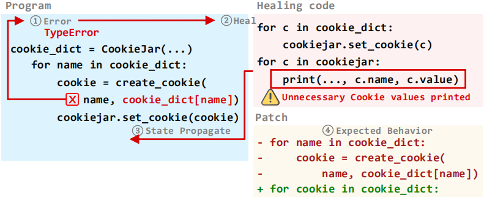
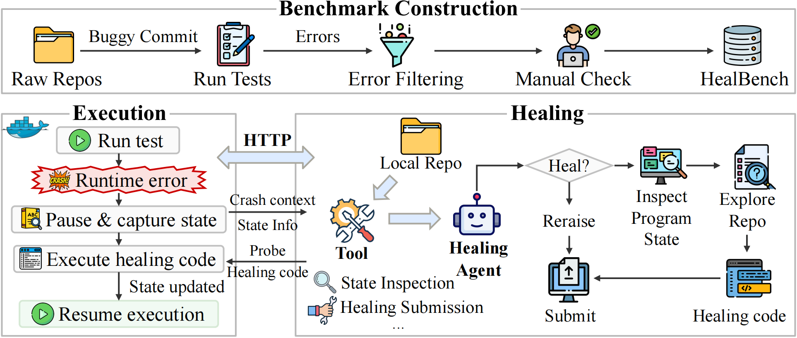

# Trustworthy Runtime Error Healing in Real-World Repositories: A Benchmark and Guardrail


**HealBench provides a benchmark and unified framework for repository-level runtime error healing; HealGuard combines HealCore restrictions with static and dynamic taint analysis to check healing dependencies on developer-protected operations.**



## Framework

1. **HealBench**: Contains 265 runtime errors from 18 real-world repositories, each paired with a target test and a patched reference execution, and provides a unified interface for repository exploration, live-state inspection, and healing submission.
2. **HealCore**: Defines an analyzable Python subset for healing code, restricting dynamic execution, reflection, definitions, and imports through a pre-execution syntax gate in the HealGuard design.
3. **HealGuard**: Checks whether healing-generated values and modified state reach developer-protected inputs through static taint analysis, with conservative pre-call dynamic checking for unknown static verdicts in its runtime design.



## Quick Start

### Installation

Requirements: Linux, Python **3.12.12**, [uv](https://docs.astral.sh/uv/), [Docker](https://www.docker.com/), **CodeQL CLI 2.26.1**, and `semgrep`.

Run from the repository root:

```bash
uv sync --frozen

# Create .env and configure your API credentials
cp .env.example .env
```

```dotenv
OPENAI_BASE_URL=https://your-provider.example/v1
OPENAI_API_KEY=YOUR_API_KEY
```

```bash
# Export credentials for the experiment launchers
set -a
. ./.env
set +a
```

Restore the pinned analysis-tool sources using [refs/README.md](refs/README.md). Configure the three model identifiers in `scripts/run_main_all.py` for your provider. Run healing in an isolated environment: generated code executes inside the live process, and side effects are not automatically rolled back.

## Experiments

The manifest contains the 265 evaluated instances. Repository restoration requires the corresponding Docker images. HealGuard analysis operates on saved executions; it does not establish online enforcement of the complete HealGuard design. This distribution includes core healing, offline Guard analysis, and metric evaluation; controlled-case construction and paper-figure scripts are not included, and original experiment results are not bundled.

```bash
# Dataset: Restore repository source code from the JSONL manifest
uv run python scripts/prepare_dataset.py --dataset datasets/healbench.jsonl --parallel 2

# Build analysis rules and instrument repositories
uv run python scripts/run_build_sink_rules.py
uv run python scripts/run_find_points_sinks.py --parallel 2
uv run python scripts/run_find_points_keypoints.py --parallel 2
uv run python scripts/run_instrument_all.py --parallel 2

# Validate the first two instances before full experiments
uv run python scripts/run_healbench_smoke.py --limit 2 --concurrency 2

# Runtime Error Healing: Compare four methods with three backbone models
uv run python scripts/run_main_all.py --agent healer
uv run python scripts/run_main_all.py --agent mini-swe-agent
uv run python scripts/run_main_all.py --agent openhands
uv run python scripts/run_main_all.py --agent codex

# Collect reference and healed execution traces
uv run python scripts/run_record_gold_trace.py --parallel 2
uv run python scripts/run_record_healed_trace.py --parallel 2

# Extract healing metrics and model usage
uv run python scripts/evaluate_paper_metrics.py --all

# Unsafe Healing Detection: Analyze saved healing records
uv run python scripts/run_guard_analysis_tracepoint.py --limit 0 --parallel 2

# Compare healing outcomes under saved Guard decisions
uv run python scripts/run_guard_analysis_tracepoint.py --metrics-csv results/healbench_evaluation/paper/all_raw.csv --filtered-output-dir results/healbench_evaluation/guard_filtered
```

## Performance of Runtime Error Healing

Paper-reported results without HealGuard on 265 instances per setting. Proceed Rate (PR) measures target-call completion; Correct Rate (CR) measures target-test success. Values are percentages; bold marks the highest score for each metric and backbone model. These results have not been reproduced end to end in this distribution.

| Method | GPT-5.6-Terra PR | GPT-5.6-Terra CR | DeepSeek-V4-Flash PR | DeepSeek-V4-Flash CR | GLM-5.2 PR | GLM-5.2 CR |
| --- | ---: | ---: | ---: | ---: | ---: | ---: |
| Healer | 29.43 | 16.98 | **24.91** | 10.94 | 7.92 | 4.91 |
| mini-SWE-agent | 36.60 | 24.53 | 20.38 | **16.23** | **32.83** | **25.28** |
| OpenHands | 29.81 | 21.51 | 9.43 | 8.30 | 15.47 | 12.08 |
| Codex | **38.11** | **28.68** | 20.00 | 15.47 | 26.42 | 20.75 |

## Citation

If you use HealBench or HealGuard in your research, please cite our paper:

```bibtex
@article{Tan2026Healing,
  author       = {Gou Tan and
                  Pengfei Chen and
                  Zhensu Sun and
                  Jieke Shi and
                  Junkai Chen and
                  Ting Zhang and
                  Weifeng Sun and
                  Junda He and
                  Shuai Liang and
                  Chuanfu Zhang and
                  Lwin Khin Shar and
                  David Lo},
  title        = {Trustworthy Runtime Error Healing in Real-World Repositories: {A}
                  Benchmark and Guardrail},
  journal      = {CoRR},
  volume       = {abs/2609.39086},
  year         = {2026},
  url          = {https://doi.org/10.48550/arXiv.2609.39086},
  doi          = {10.48550/ARXIV.2609.39086},
  eprinttype   = {arXiv},
  eprint       = {2609.39086},
}
```

## License

[LICENSE](LICENSE).